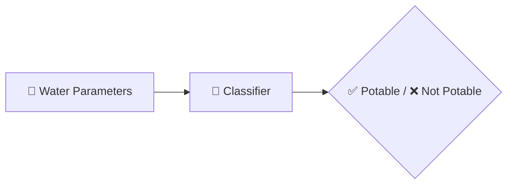

<div align="center">


<b><i>Is your water safe to drink? Let ML decide.</i></b>


      

   
</div>

---

## 💧 About the Project

Predicts whether water is **safe to drink (potable)** from nine water-quality parameters — **pH, hardness, solids, chloramines, sulfate, conductivity, organic carbon, trihalomethanes and turbidity** — using a classification model trained on the `water_potability.csv` dataset.

## ✨ Key Features

- 🧪 9 water-quality inputs
- 🧹 Missing-value handling & EDA in `water quality.ipynb`
- 🤖 Trained classifier (`model.pkl`)
- ✅ Clear **Potable / Not Potable** result page

## 🧠 How It Works



## 🛠️ Tech Stack

| Layer | Technology |
|---|---|
| Language | Python 3 |
| Data & ML | Pandas · NumPy · scikit-learn |
| Notebook | Jupyter |
| Web App | Flask + Jinja2 templates |
| Frontend | HTML5 · CSS3 |

## 📂 Project Structure

```text
WATER-POTABILITY-PREDICTION/
├── app.py
├── water quality.ipynb
├── water_potability.csv
├── model.pkl
├── static/style.css
└── templates/ (base, home, result)
```

## 🚀 Getting Started

```bash
git clone https://github.com/PreciousBharath/WATER-POTABILITY-PREDICTION.git
cd WATER-POTABILITY-PREDICTION
pip install flask pandas numpy scikit-learn
python app.py
```

## 🤝 Contributing

Contributions, issues and feature requests are welcome! Feel free to ⭐ star the repo and open a pull request.

## 👨‍💻 Author

<div align="center">

**Bharath** — Software Developer · Project Engineer · Technical Trainer

<a href="https://github.com/PreciousBharath"></a>
<a href="https://linkedin.com/in/connectbharath"></a>

### 🍔 EAT · 😴 SLEEP · 💻 CODE · 🔁 REPEAT

⭐ **If you found this project useful, give it a star!** ⭐


</div>
